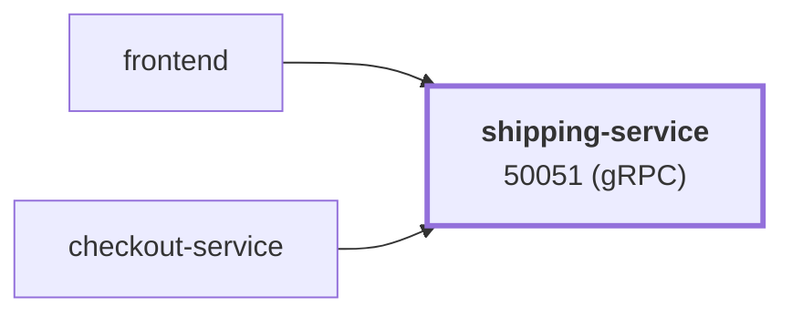

# shipping-service

service · platform-demo

A gRPC service that provides shipping quotes and "ships" orders for the platform-demo e-commerce platform. It is a simulation: quotes are a flat rate and `ShipOrder` just fabricates a tracking ID. It is stateless, has no downstream dependencies, and is called by `checkout-service` (and by `frontend` for the cart-page shipping estimate).

Runtime<strong>Go 1.25</strong><small>Go</small>

Listens on<strong>50051</strong><small>gRPC</small>

State<strong>Stateless</strong>

Image<strong>shipping-service</strong><small>mladenovskistefan/</small>

## Where it sits

Called by `frontend`, `checkout-service`. It has no downstream dependencies.

## At a glance

| | |
|---|---|
| **Language / runtime** | Go 1.25 (static binary, `CGO_ENABLED=0`) |
| **Image** | `mladenovskistefan/shipping-service` |
| **Protocol / port** | gRPC (HTTP/2, plaintext) on `50051` |
| **Metrics** | Pushed over OTLP/gRPC (Prometheus registry bridged into OpenTelemetry); `/metrics` on `9090` is still served for debugging |
| **Health** | Standard `grpc.health.v1.Health/Check` on `50051` — static `SERVING` |
| **State** | None |
| **Depends on** | Nothing (optional: OTLP collector, Pyroscope) |
| **Called by** | `checkout-service` (`GetQuote`, `ShipOrder`), `frontend` (`GetQuote`) |
| **gRPC reflection** | Enabled — `grpcurl` works without `-proto` |

## Find it elsewhere

<h4><a href="https://argocd.platform-demo.test/applications/argocd/dev-shipping-service">Argo CD</a></h4>
Sync and health of <code>dev-shipping-service</code>.

<h4><a href="https://grafana.platform-demo.test/d/shipping-service-overview">Grafana</a></h4>
Latency, traffic and errors (<code>shipping-service-overview</code>).

<h4><a href="https://github.com/platform-boutique/app-shipping-service">Repository</a></h4>
Source, pull requests and releases of <code>app-shipping-service</code>.

!!! info "Part of the platform-demo platform"
    Cross-cutting facts (service wiring, observability contract, Kubernetes translation, CI/CD) are in the
    [master reference](https://github.com/platform-boutique/platform-demo-docs). This site only describes shipping-service.
